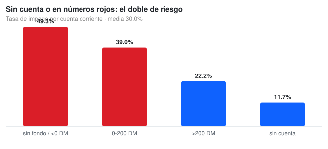
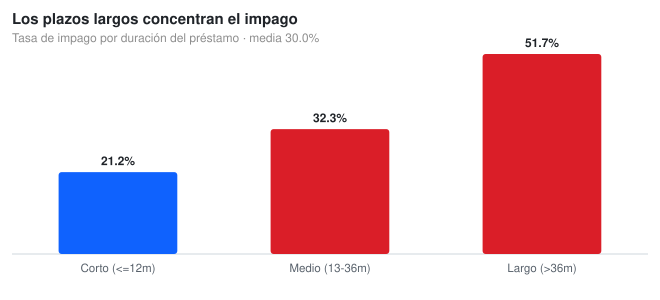
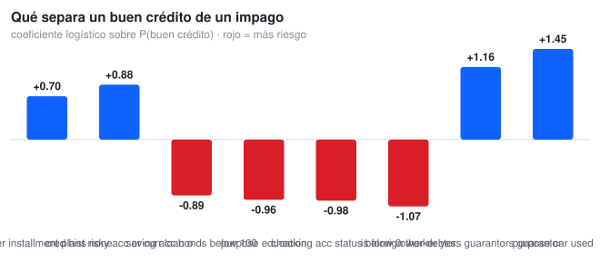

# 🏦 German Credit Scoring Data

**Who defaults, why, and how much it would cost to be wrong**

[](https://www.python.org/)
[](https://scikit-learn.org/)
[](https://opensource.org/licenses/MIT)

---

## The business question

A bank reviews **1,000 credit applications** knowing that **three in ten will not be repaid**. The two mistakes do not cost the same: a default costs the principal lent, while rejecting a good customer only costs the margin. So the question is not *how much* risk exists but **which variables separate it and where it concentrates**.



---

## What the data says

### The checking account is the strongest single signal

**49.3%** of applicants with their account in the red default, against **11.7%** of those with no account at all. The gradient is monotonic: 39.0% for 0–200 DM and 22.2% above 200 DM.

### Term length nearly triples the risk



**21.2%** of loans of a year or less end in default, against **51.7%** of those over 36 months. Age matters less than expected: 40.9% under 25 versus 24.9% over 45 — the gap is between the youngest group and everyone else.

### What separates a good loan from a default



The model estimates **P(good credit)**, so a **negative** coefficient means **more** default risk:

| Attribute | Coefficient | Odds ratio | Reading |
|:--|--:|--:|:--|
| Purpose: used car | +1.45 | 4.27 | Used-car loans repay best in this data |
| Guarantor present | +1.16 | 3.20 | A co-signer is real protection |
| Foreign worker | −1.07 | 0.34 | See the fairness warning below |
| Checking account in the red | −0.98 | 0.38 | Highest-risk segment |
| Purpose: education | −0.96 | 0.38 | 44.0% default rate |
| Savings below 100 DM | −0.89 | 0.41 | Thin cushion, more risk |
| Risky credit history | +0.88 | 2.41 | Counter-intuitive sign, see limits |
| No other installment plans | +0.70 | 2.00 | Less existing debt load |

**Model performance:** AUC **0.772**, accuracy 0.696 on a 25% hold-out (750 train / 250 test). For credit risk the metric that matters is the **recall on defaults: 0.68** with precision 0.50 — of every 100 real defaults it catches 68, and of every 100 alerts 50 are real.

---

## Reproduce it

```bash
git clone https://github.com/Nicolenki7/German_Credit_Scoring_Data.git
cd German_Credit_Scoring_Data

python -m venv .venv && source .venv/bin/activate
pip install -r requirements.txt

python src/credit_analysis.py   # regenerates outputs/ and every SVG in docs/img
```

The dataset is committed (`german_credit_cleaned.csv`, 1,000 rows, 21 columns), so nothing is downloaded and the numbers are reproducible as-is. The notebook walks through the same steps with the reasoning spelled out.

---

## Repo layout

```
German_Credit_Data.ipynb              notebook: SQL features, charts, model, findings
src/credit_analysis.py                the whole analysis end to end, from the CLI
src/svg_chart.py                      tiny dependency-free SVG bar chart generator
german_credit_cleaned.csv             model-ready dataset (21 columns)
german_credit_FINAL_FOR_BI.csv        one-hot table for BI tools (56 columns)
docs/img/*.svg                        the three charts used in this README
outputs/                              coefficients + scored dataset (generated)
```

---

## Method

**SQL feature engineering.** The cleaned frame goes into an in-memory SQLite database and comes out with three extra columns: `Debt_to_Duration_Ratio` (catches aggressive loans), `Tramo_Edad` and `Tramo_Plazo`. The last two are the cuts used in the charts, so the logic lives in one place.

**Model.** Logistic regression with `class_weight='balanced'` (the base is 30% defaults), one-hot encoding with `drop_first=True`, and **standardised numeric features**: without scaling the solver does not converge and coefficient signs stop making sense — the red checking account showed up as a protective factor. Stratified 75/25 split, fixed seed.

**Why logistic and not a forest.** A credit decision has to be explainable to the applicant and to a regulator. The coefficients are the deliverable; two points of AUC are not worth losing the explanation.

---

## Limitations

- **This dataset contains a sensitive attribute** (`is_foreign_worker`) with a high coefficient. It describes a 1990s German dataset, **not** a lending policy: using it to decide would be discrimination and, in the EU, illegal. It is reported here because hiding it would be worse than flagging it.
- A single 75/25 split with 250 test cases: AUC and recall carry wide, unmeasured confidence intervals. With 1,000 rows, a cross-validated range would be more honest.
- Coefficients are associations, not causes. Numeric ones are standardised, so their magnitude is *per standard deviation* — comparable to each other, not in euros.
- The 0.5 threshold is a placeholder. A real decision rule should come from the cost of a default versus the margin lost on a rejected good customer.

## Where this would go next

Replace the fixed threshold with a cost matrix: what a default costs against the margin lost when a good customer is rejected. That turns the output from a probability into a decision with a price attached.

---

## 📝 Resumen en Español

Un banco evalúa 1.000 solicitudes y sabe que 3 de cada 10 no se devuelven. El análisis muestra dónde se concentra el riesgo (cuenta corriente en rojo: 49,3 % frente a 11,7 %; plazos de más de 36 meses: 51,7 %) y qué variables lo separan con un modelo logístico interpretable (AUC 0,772, recall de impagos 0,68). Los gráficos salen del pipeline, no están dibujados a mano.

---

## 🔗 Links

| Resource | URL |
| :--- | :--- |
| **Repository** | https://github.com/Nicolenki7/German_Credit_Scoring_Data |
| **Dataset** | [German Credit on UCI](https://archive.ics.uci.edu/ml/datasets/statlog+(german+credit+data)) |

---

## 📄 License

MIT License

---

## 👤 Author

**Nicolás Zalazar** | Data Analyst · Aspiring Data Engineer · Mallorca, Spain

- GitHub: [@Nicolenki7](https://github.com/Nicolenki7)
